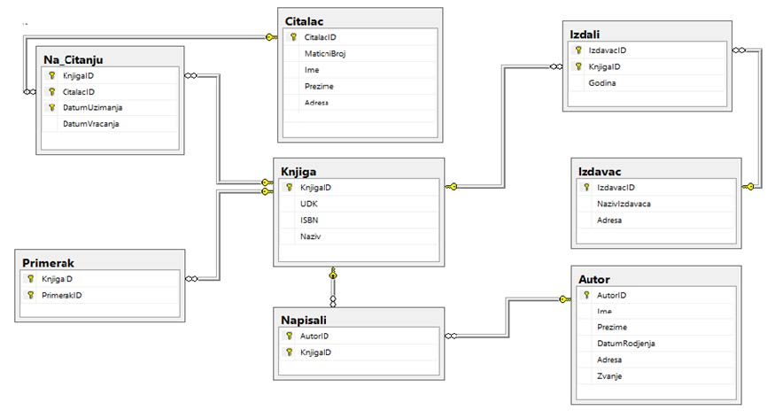
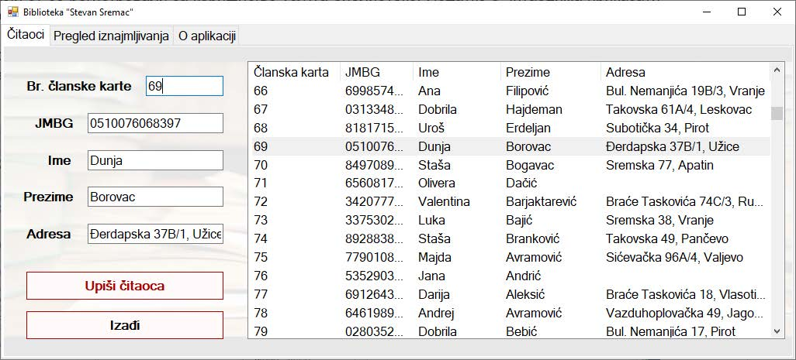
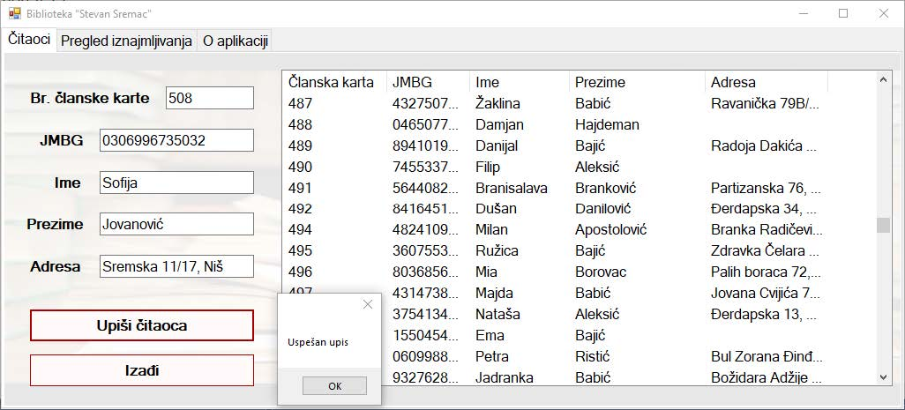
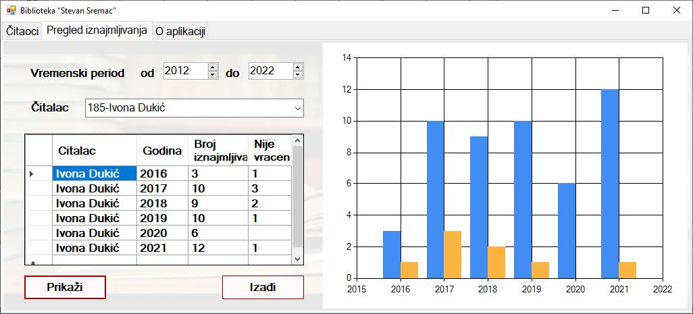

# 4ЕИТ–А1: Израда десктоп апликације: Библиотека

Управа градске библиотеке је исказала потребу за креирањем апликације за вођење
евиденције о насловима који су на располагању у библиотеци. Аликација би требала осим
могућности уноса, брисања и измена података о расположивим насловима, писцима,
корисницима и изнајмљивању да има и могућност генерисања потребних извештаја. Део
активности у изради апликације делегиран је вашем тиму.

На основу спецификације дате у Прилогу задатка урадити следеће:

- Дизајнирати десктоп апликацију у циљу задовољења захтева;
- Повезати десктоп апликацију са базом података;
- Креирати упите за манипулацију подацима у бази података;
- Тестирати функционалности десктоп апликације;
- Модификовати структуру базе података у складу са захтевима корисника;
- Написати упутство корисницима о коришћењу апликације;
- ЕР дијаграм, бекап базе и апликацију запамтити на десктопу рачунара, у фолдеру
Матурски_испит_4ЕИТ\Име_Презиме\4ЕИТ_А1, где се као име и презиме уноси име
ученика.

Предвиђено време за израду задатка је 180 минута.

По истеку максималног времена задатак се прекида и бодује се оно што је до тада урађено.
У оквиру времена за израду задатка ученик може да одустане од даљег рада, при чему се
бодује оно што је до тада урађено.

Прилоге преузети из фолдера 4ЕИТ на десктопу рачунара.

Дијаграм почетне структуре базе дат је као [Прилог_4ЕИТ_А11](./images/a01_baza.jpg).

Резервна копија почетног стања базе дата је као [Прилог_4ЕИТ_А12.](./sql/Biblioteka.sql)

Архива слика и икона дата је као Прилог_4ЕИТ_А00.

## ПРИЛОГ

Креирати форму која има три таба. На првом табу се приказују подаци о свим корисницима –
читаоцима који су се регистровали за коришћење услуга библиотеке. Податке о читаоцима
приказати у `listView` контроли.

Шифра читаоца је број чланске карте читаоца. Уносом шифре у одговарајуће, уколико постоји
читалац са унетом шифром, податке о том читаоцу треба приказати у осталим пољима форме.
Ако унета шифра не постоји у бази или ако је поље шифре празно, ресетовати садржај осталих
текстуалних поља на форми.

Кликом на дугме Упиши читаоца, уписати читаоца чији су подаци унети у поља форме и
уколико је упис успешан, приказати шифру на коју је у бази уписан нови читалац. После
успешног уноса променити приказ на форми. Да не би случајним кликом на дугме за упис
дошло до вишеструког уписивања истог читаоца, дугме учинити доступним (енејбловано) само
онда када су сва поља за унос података о новом читаоцу празна. После уноса, дугме Упиши
треба поново искључити (дисејбловати). Дугме Изађи затвара целу апликацију.

Други таб форме организовати као на скици. ComboBox треба попунити тако да се за сваког
читаоца види шифра, име и презиме. Кликом на дугме Прикажи, потребно је за избраног
читаоца, за сваку годину током временског периода задатог у годинама, приказати
колико је књига корисник позајмио из библиотеке, као и колико књига није вратио
(ако књига није враћена, у бази није уписан датум враћања). Ако временски период
није другачије задат, подразумевано се приказују подаци за последњих 10 година.

Податке приказати на форми у dataGridView контроли, као и на графику. На x оси су
године, а на y оси број изнајмљивања.

На трећем табу је исписано кратко корисничко упутство и документација о апликацији.

Библиотека отвара већи број огранака у школама у околини и потребно је чувати податке и о
школама у којима су отворени огранци библиотеке. За сваки примерак књиге треба памтити у
ком огранку се налази Такође је потребно памтити и када је књига набављена. Обезбедити
кроз ограничења у бази да датум набавке не може да буде старији од датума оснивања
библиотеке (01.01.2000). Креирати дијаграм и бекап стања проширене базе.
