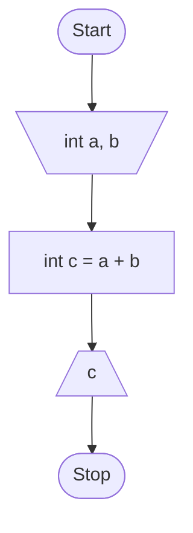
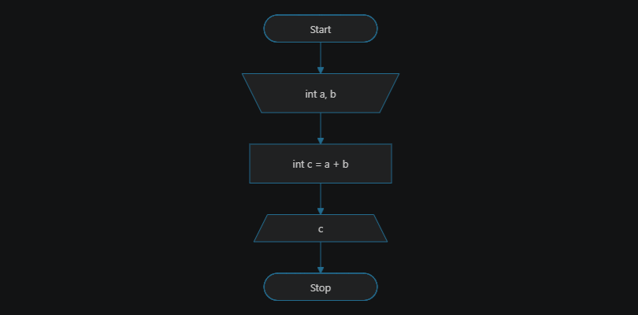
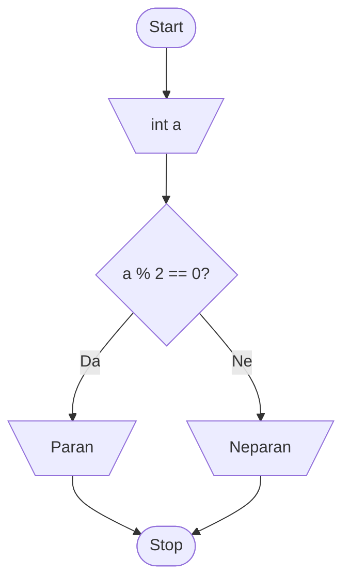
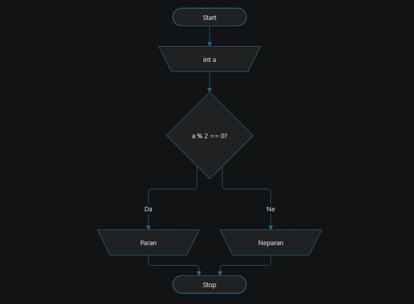
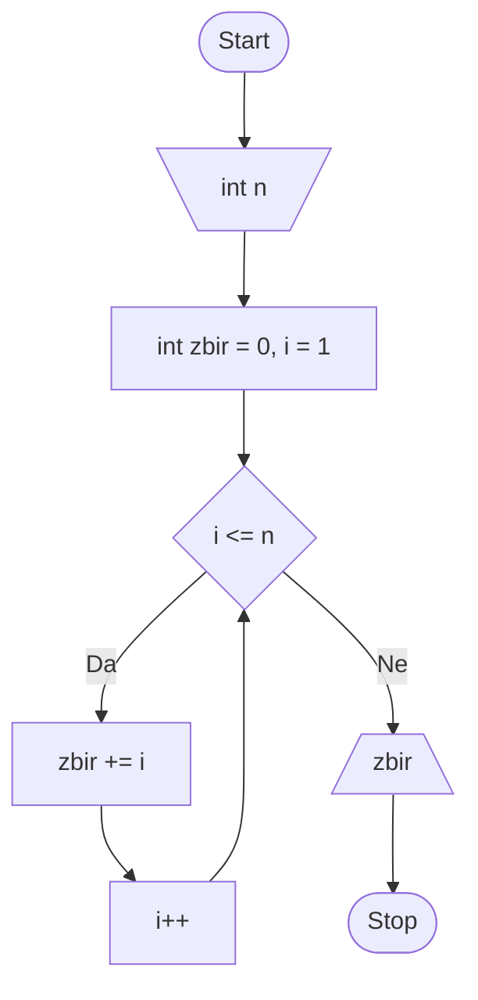
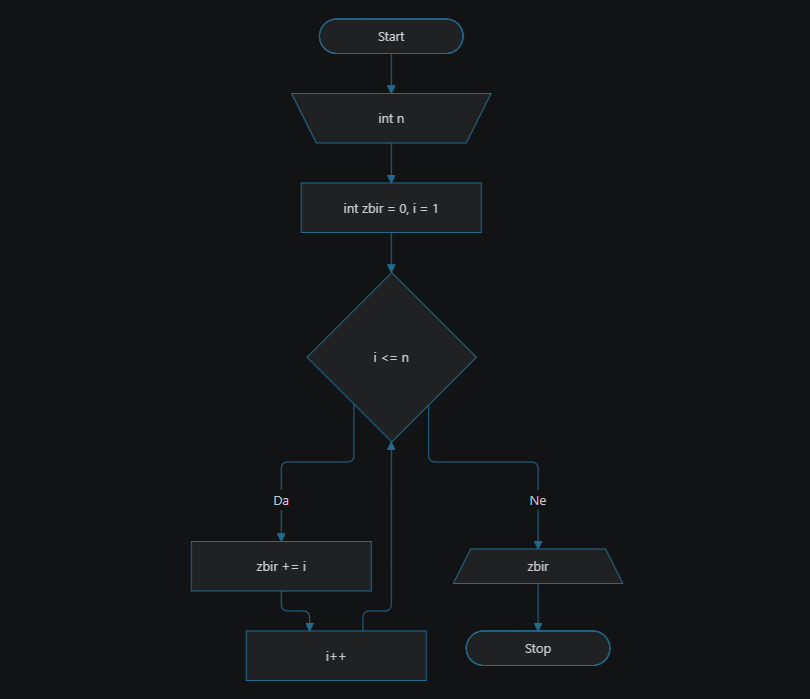

# Израда дијаграма тока

У оквиру ове лекције научићеш како се помоћу алата Mermaid-а праве дијаграми
тока, односно алгоритамске шеме за основне алгоритамске структуре које си учио
у првом разреду у оквиру предмета Програмирање.

## Основни симболи дијаграма тока

Дијаграм у Markdown документу треба да унесеш унутар блока кода који почиње
ознаком `mermaid`. Након тога, у следећем реду, треба да наведеш тип дијаграма,
на пример, дијаграм тока који иде од врха ка доле `flowchart TD` (*Top-Down*),
или дијаграм тока који иде са лева на десно `flowchart LD` (*Left to Right*).
Сви смерови које можеш дефинисати су:

- `TB` (енгл. *Top to bottom*) - од врха ка дну,
- `TD` (енгл. *Top-down*) - од врха ка доле - исто као `TB`,
- `BT` (енгл. *Bottom to top*) од дна ка врху,
- `RL` (енгл. *Right to left*) - са десна на лево и
- `LR` (енгл. *Left to right*) - са лева на десно.

Облици за почетак и крај дефинишу се као `id([tekst])` (енгл. *stadium-shaped
node*). Облици за унос и испис података дефинишу се као паралелограми
`id[/tekst/]` или `id[\tekst\]` (енгл *parallelogram* или *parallelogram alt*),
или као трапезоиди `id[\tekst/]` и `id[/tekst\]` (енгл. *trapezoid* или
*trapezoid alt*). Процес треба да дефинишеш обликом правоугаоника као
`id[tekst]` (енгл. *node with text*), док стрелице треба да дефинишеш као
`-->`.

## Дијаграм тока линијске структуре

Линијска структура програма представља најједноставнији облик алгоритма.
Наредбе се извршавају једна за другом, редоследом којим су написане, где не
постоји провера услова нити понављање наредби. Нека је задатак да нацрташ
дијаграм тока за израчунавање збира два цела броја, па на основу тог дијаграма
тока напишеш програм у језику C#.

````markdown

````

У овом примеру, сваком облику на дијаграму додељен је идентификатор (`A`, `B`,
`C`, `D` и `E`), а везе између облика дефинисане су стрелицама `-->`. Mermaid
ће овај дијаграм тока нацртати овако...



...док програм можеш да напишеш овако:

```csharp
using System;

class Program
{
    static void Main()
    {
        int a = int.Parse(Console.ReadLine());
        int b = int.Parse(Console.ReadLine());
        int c = a + b;
        Console.WriteLine(c);
    }
}
```

## Дијаграм тока разгранате структуре

Разграната структура омогућава да се на основу испуњености одређеног услова
изабере један од могућих путева извршавања алгоритма. Да би на дијаграму тока
приказао гранање, треба да користиш облик ромба `id{tekst}` (енгл. *rhombus*).
Нека је задатак да нарташ дијаграм тока и напишеш програм који учитава један
цео број и проверава да ли је унети број паран или непаран. Дијаграм тока кога
дефинишеш овако...

````text

````

...Mermaid ће нацртати овако...



...а C# програм који пишеш на основу њега може да изгледа овако:

```csharp
using System;

class Program
{
    static void Main()
    {
        int a = int.Parse(Console.ReadLine());
        if (a % 2 == 0)
            Console.WriteLine("Paran");
        else
            Console.WriteLine("Neparan");
    }
}
```

У овом примеру у ромбу је представљена провера услова `a % 2 == 0`. У
зависности од резултата провере, алгоритам наставља једним од два могућа пута:
ако је услов испуњен (срелица са текстом `-->|Da|`) приказује се порука да је
број паран, или ако услов није испуњен (срелица са текстом `-->|Ne|`),
приказује се порука да је број непаран.

## Дијаграм тока цикличне структуре

Циклична структура омогућава да се једна или више наредби извршавају више пута,
све док је испуњен одређени услов или док се не испуни услов за прекид
понављања. Нака је задатак на нацрташ дијаграм тока и на основу њега напишеш
програм у језику C# којим се учитава природан број `n` и израчунава збир свих
природних бројева од `1` до `n`. Дијаграм тока кога дефинишеш овако...

````text

````

...Mermaid ће нацртати овако...



...а C# програм који пишеш на основу њега може да изгледа овако:

```csharp
using System;

class Program
{
    static void Main()
    {
        int n = int.Parse(Console.ReadLine());
        int zbir = 0;
        for (int i = 1; i <= n; i++)
            zbir += i;
        Console.WriteLine(zbir);
    }
}
```

## Остали елементи на дијаграму

Током рада сигурно ћеш наићи на потребу за израдом сложенијих дијаграма тока са
разноврснијим облицима који нису представљени у овој лекцији. Поред наведених
облика...

- процес (*Node with text*): `id[tekst]`,
- почетак/крај (*Stadium-shaped node*): `id([tekst])`,
- унос/испис (*Trapezoid* и *Trapezoid alt*): `id[\tekst/]` и `id[/tekst\]`,
- унос/испис (*Parallelogram* и *Parallelogram alt*): `id[/tekst/]` и `id[\tekst\]`,
- услов (*Rhombus node*): `id{tekst}`,

...основни Mermaid облици су и:

- правоугаоник са заобљеним ивицама (*Node with round edges*): `id(tekst)`,
- предефинисани процес (*Node in a subroutine shape*): `id[[tekst]]`,
- цилиндар (*Node in a cylindrical shape*): `id[(tekst)]`,
- круг (*Node in the form of a circle*): `id((tekst))`,
- асиметрични облик (*Node in an asymmetric shape*): `id>tekst]`,
- хексагон (*Hexagon node*): `id{{tekst}}` и
- дупли круг (*Double circle*): `id(((tekst)))`.

Mermaid је библиотека која се стално развија, па је тако у верзији 11.3.0+
уведено 30 додатних облика који се дефинишу "општом" синтаксом:

```text
id@{ shape: nazivOblika }
```

Списак назива свих облика можеш пронаћи на званичном
[Mermaid.js](https://mermaid.js.org/syntax/flowchart.html) веб сајту.

Поред стандардне стрелице `-->` коју си већ користио у досадашњим примерима,
Mermaid омогућава да облике повезујеш и другим везама:

| Тип                          |   1    |    2    |    3     |
| ---------------------------- | :----: | :-----: | :------: |
| Линија                       | `---`  | `----`  | `-----`  |
| Линија са стрелицом          | `-->`  | `--->`  | `---->`  |
| Дебела линија                | `===`  | `====`  | `=====`  |
| Дебела линија са стрелицом   | `==>`  | `===>`  | `====>`  |
| Тачкаста линија              | `-.-`  | `-..-`  | `-...-`  |
| Тачкаста линија са стрелицом | `-.->` | `-..->` | `-...->` |

Више о везама између облика можеш такође пронаћи на званичном
[Mermaid.js](https://mermaid.js.org/syntax/flowchart.html) веб сајту.
