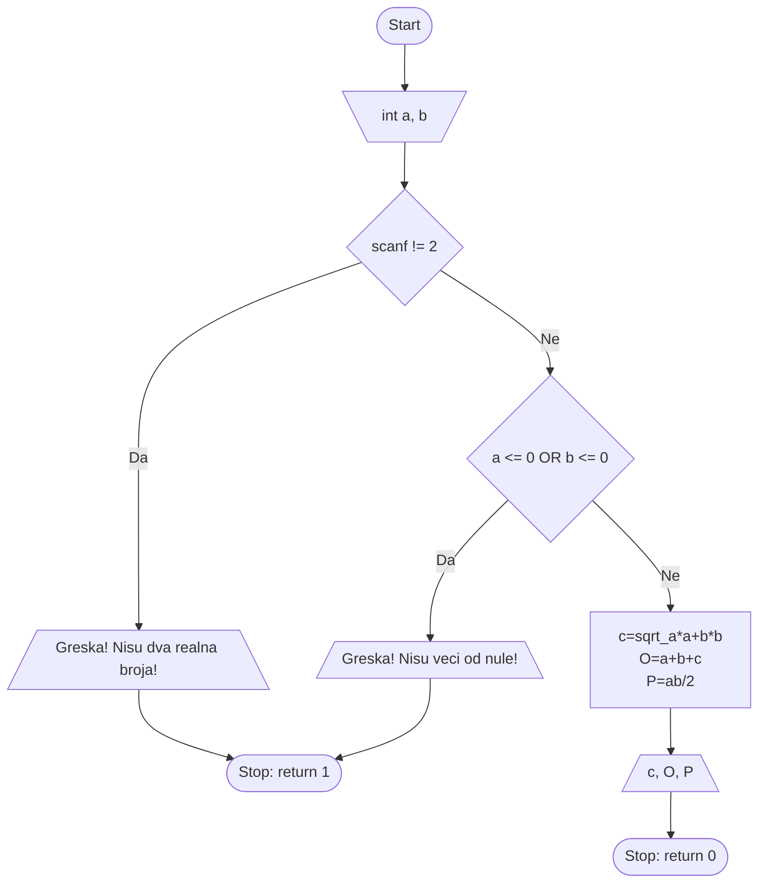

# Израчунавање параметара правоуглог троугла

## Текст задатка

Креиран је програм у програмском језику C који за унете дужине катета $a$ и $b$
правоуглог троугла израчунава и исписује дужину хипотенузе $c$, обим $O$ и
површину $P$ тог троугла, заокружене на четири децимале. Програм треба да
обезбеди проверу исправности улазних података:

* Уколико корисник не унесе два реална броја, програм исписује одговарајућу
поруку о грешци и прекида извршавање (враћа статусни код `1`).
* Уколико унете вредности нису позитивни реални бројеви ($a \le 0$ или
$b \le 0$), програм такође исписује поруку о грешци и прекида извршавање.

## Математички модел

За правоугли троугао са катетама $a, b > 0$:

**Хипотенуза** помоћу Питагорине теореме израчунава се на следећи начин:

$$c = \sqrt{a^2 + b^2}$$

**Обим троугла** израчунава се на следећи начин:

$$O = a + b + c$$

**Површина троугла** израчунава се на следећи начин:

$$P = \frac{a \cdot b}{2}$$

## Алгоритамска шема (дијаграм тока)



## Изворни код програма

```c
#define _CRT_SECURE_NO_WARNINGS
#include <stdio.h>
#include <math.h>

int main(void)
{
    double a, b, c, O, P;
    printf("Unesi duzine kateta a i b: ");
    if (scanf("%lf %lf", &a, &b) != 2)
    {
        printf("Greska! Moras uneti dva realna broja!");
        return 1;
    }
    if (a <= 0 || b <= 0)
    {
        printf("Greska! Brojevi moraju biti veci od nule!");
        return 1;
    }
    c = sqrt(a * a + b * b);
    O = a + b + c;
    P = (a * b) / 2.0;
    printf("c = %.4lf, O = %.4lf, P = %.4lf", c, O, P);
    return 0;
}
```

## Тест примери

Тест пример за исправан унос:

```text
Unesi duzine kateta a i b: 4 6
c = 7.2111, O = 17.2111, P = 12.0000
```

Тест пример за неисправан унос када унета дужина није већа од $0$:

```text
Unesi duzine kateta a i b: 4 -6
Greska! Brojevi moraju biti veci od nule!
```

Тест пример за неисправан унос када унете дужине нису реални бројеви:

```text
Unesi duzine kateta a i b: tri cetiri
Greska! Moras uneti dva realna broja!
```
