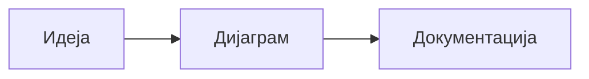

# Језик за моделовање система UML

У претходним лекцијама видео си да тим има своје улоге, да пројекат има
ограничења и да развој пролази кроз фазе. У свакој од тих фаза чланови тима
морају да се договоре о томе шта граде. Речи су за то често непрецизне: две
особе исту реченицу могу да разумеју на два различита начина.

Зато девелопери, пре него што започну са развојем, пре писања кода скицирају
**модел** — поједностављен приказ система који истиче оно што је важно, а
изоставља остало. Модел помаже да:

* боље разумеш проблем пре него што почнеш да програмираш;
* размениш идеје унутар тима и са наручиоцем посла;
* уочиш грешке у дизајну док их је још "јефтино" исправити;
* оставиш документацију онима који ће пројекат наставити.

## Шта је UML?

Унифицирани језик за моделовање **UML** (енгл. *Unified Modeling Language*) је
стандардизован графички језик за приказивање структуре и понашања софтверских
система. Важно је разумети шта UML *није*: он није програмски језик и не може
се извршити. То је **нотација** — договорени скуп облика и правила којима црташ
дијаграме тако да их сви читају на исти начин.

Кратка историја: почетком 1990-их постојало је десетак различитих начина за
цртање софтверских модела. Три аутора, Grady Booch, James Rumbaugh и Ivar
Jacobson, обједињила су своје приступе у једну нотацију. Организација OMG
(енгл. *Object Management Group*) прихватила је UML 1997. године, а 2005.
постао је и међународни ISO стандард. Данас се користи **UML 2.x**.

UML се користи на два начина: као **скица** (брзо, на табли или папиру, да се
тим договори) и као **формална спецификација** (прецизно, уз помоћ алата). У
школи и у већини малих тимова користи се као скица - циљ није савршен цртеж,
већ јасна комуникација.

## Врсте UML дијаграма

UML 2 дефинише 14 врста дијаграма, подељених у две групе.

**Структурни дијаграми** показују *од чега се систем састоји* - делове система
и њихове међусобне односе:

| Дијаграм                                  | Чему служи                                                |
| ----------------------------------------- | --------------------------------------------------------- |
| Class (класа)                             | класе, њихови атрибути и методе и односи међу њима        |
| Object (објеката)                         | "снимак" објеката и њихових веза у одређеном тренутку     |
| Component (компоненти)                    | делови система и интерфејси преко којих сарађују          |
| Deployment (размештаја)                   | на ком се хардверу или серверу извршава који део софтвера |
| Package (пакета)                          | груписање елемената у пакете и зависности међу пакетима   |
| Composite structure (унутрашње структуре) | унутрашња структура једне класе или компоненте            |
| Profile (профила)                         | прилагођавање UML-а одређеној области                     |

**Дијаграми понашања** показују *шта систем ради* и како се мења током времена:

| Дијаграм                                    | Чему служи                                                         |
| ------------------------------------------- | ------------------------------------------------------------------ |
| Use case (случајева коришћења)              | шта корисници могу да раде са системом                             |
| Activity (активности)                       | ток корака, одлуке и паралелни токови                              |
| State machine (стања)                       | стања у којима објекат може да буде и прелази међу њима            |
| Sequence (секвенце)                         | размена порука између објеката, редом којим се дешава              |
| Communication (комуникације)                | исте поруке као у секвенци, али с нагласком на везе међу објектима |
| Timing (времена)                            | промене стања у тачно одређеним тренуцима                          |
| Interaction overview (интеракције)          | комбинација дијаграма активности и дијаграма интеракције           |

Није потребно знати свих 14 напамет. У пракси се најчешће користе use case,
class, sequence, activity и state machine дијаграм.

Најлакши начин да одабереш дијаграм јесте да се упиташ шта желиш да прикажеш:

| Питање                                                | Дијаграм             |
| ----------------------------------------------------- | -------------------- |
| Ко користи систем и шта све може да ради?             | use case             |
| Од којих класа се програм састоји и како су повезане? | class                |
| Како објекти размењују поруке и којим редом?          | sequence             |
| Којим редом се извршавају кораци неког поступка?      | activity (flowchart) |
| Кроз која стања пролази објекат, нпр. поруџбина?      | state machine        |
| На ком серверу ради који део система?                 | deployment           |

У наредним лекцијама биће обрађене три врсте дијаграма, јер покривају највећи
део свакодневних потреба:

* **flowchart** дијаграм - дијаграм тока тј. алгоритамска шема,
* **class** дијаграм и
* **sequence** дијаграм.

> Алгоритамске шеме су много старије од UML-а и не представљају његов део.
> Најближи UML еквивалент је activity дијаграм, који се користи на сличан начин.
> Пошто си већ научио да креираш алгоритамске шеме у Flowgorithm-у у I разреду у
> оквиру предмета Програмирање, то ће бити и први тип дијаграма којег ћеш научити
> да креираш помоћу mermaid.js-а.

## Шта је Mermaid

**Mermaid** је JavaScript библиотека која дијаграме црта на основу
**текстуалног описа**. Уместо да облике "црташ", довољно је да напишеш неколико
редова текста, а Mermaid ће од њих креирати дијаграм. Ова идеја зове се
"дијаграми као код" (*Diagrams As Code*).

Предности оваквог приступа су многобројне. Дијаграм је обичан текст, па се чува
у текстуалном фајлу као и код. Ако има измена на дијаграму, Git командама
моћићеш да видиш шта је тачно промењено и ко је и када извршио измене. Овако
сачувна дијаграм можеш брзо да измениш, а све ради у прегледачу, није потребан
посебан програм. Поред flowchart и UML дијаграма Mermaid подржава и дијаграме
стања, ER дијаграме, Gantt дијаграме, кружне дијаграме итд. Једина права мана
Mermaid дијаграма је да распоред елемената на дијаграму одређује Mermaid
аутоматски, па над изгледом дијаграма имаш мање контроле него у алатима за
цртање.

## Mermaid у GitHub markdown документима

Као што блок кода пишеш између три обрнута апострофа, а иза отварајућих
апострофа наводиш језик, тако и Mermaid дијаграме црташ "на `mermaid` језику" -
уместо исписа кода приказаће се готов дијаграм. На пример:

````markdown

````


