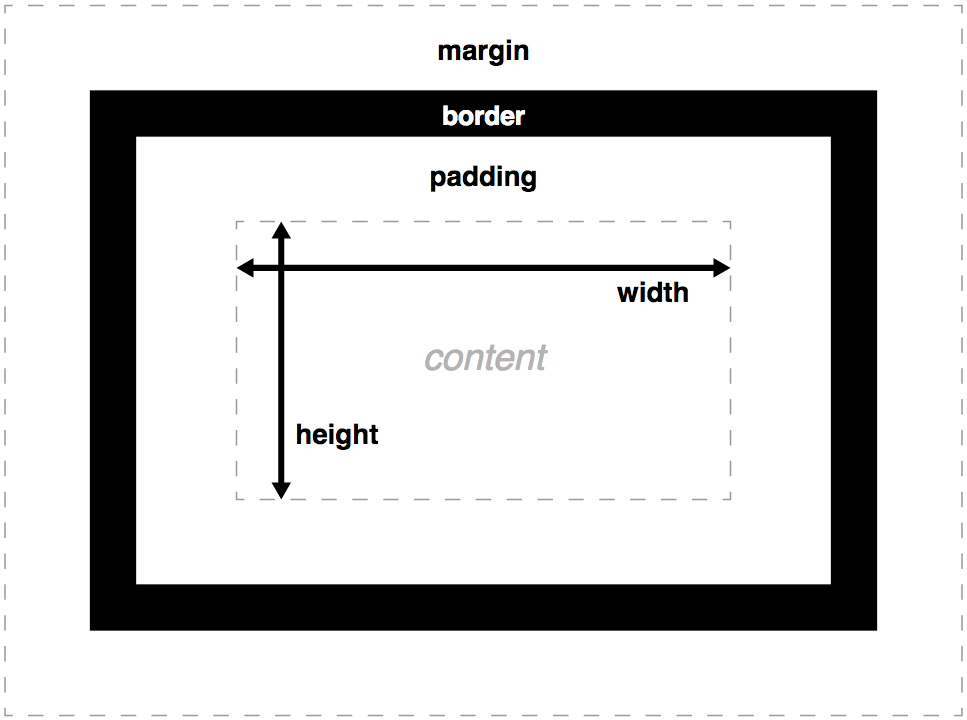

# Бокс модел

Када прегледач приказује веб страницу, сваки елемент третира као кутију тј.
**правоугаоник** - тај принцип назива се бокс модел тј. модел кутије (енгл.
*box model*). У следећем примеру у телу странице налазе се три елемента -
наслов и два пасуса текста:

``` html
<h1>Добродошли</h1>
<p>Ово је први пасус текста.</p>
<p>Ово је други пасус текста.</p>
```

Теби изгледа као да страница садржи три линије текста, а прегледач "у позадини"
види три кутије, поређане једна испод друге. Отвори ову веб страницу у
прегледачу па притисни `Ctrl` + `Shift` + `C` (или десни клик па
`Inspect`/`Elements`). Пређи мишем преко елемената у панелу `Elements` –
прегледач ће обојити кутију сваког елемента.

??? warning "Нису све кутије исте!"
    | | **Блоковски** (`block`) | **Линијски** (`inline`) |
    | --- | --- | --- |
    | Примери | `<div>`, `<p>`, `<h1>`, `<ul>` | `<span>`, `<a>`, `<strong>`, `<em>` |
    | Нови ред | Почиње у новом реду | Наставља се у истом реду |
    | Ширина | Заузима сву расположиву ширину | Само онолико колико садржај захтева |
    | `width` / `height` | Примењују се | **Не примењују се** |
    | Вертикални `margin` | Утичу на распоред | Не утиче на распоред линија текста |
    | Вертикални `padding` и `border` | Утичу на распоред | Не повећавају висину оквира |
    
    Понашање линијских (`inline`) елемената можеш променити овако:
    ```css
    linijskiElement {
    display: inline-block;
    }
    ```
    Линијски елемент чијем својству `display` доделиш вредност `inline-block`
    остаје у реду са текстом као линијски елемент, али прихвата `width`, `height`,
    `padding` и `margin` као блоковски.

## Делови кутије

Свака кутија састоји се од четири слоја, изнутра ка споља:

| Слој                                        | CSS својство      | Улога                                                      |
| ------------------------------------------- | ----------------- | ---------------------------------------------------------- |
| **Садржај** тј. контент (*content*)         | `width`, `height` | Простор за било који садржај                               |
| **Унутрашњи размак** тј. пединг (*padding*) | `padding`         | Размак између садржаја и оквира                            |
| **Оквир** тј. бордер (*border*)             | `border`          | Линија која уоквирава кутију                               |
| **Спољашњи размак** тј. маргина (*margin*)  | `margin`          | Спољашњи размак између оквира елемента и околних елемената |



!!! note "Важно"
    Позадина (`background`) се простире испод садржаја, унутрашњег размака и
    оквира, али **не и испод спољашњег размака** - позадина испод спољашњег
    размака је провидна!

[Више о бокс моделу на MDN-у](https://developer.mozilla.org/en-US/docs/Web/CSS/Guides/Box_model)

## Својства кутије

Унеси један поднаслов и један пасус текста унутар елемента `div`:

```html title="index.html"
<div class="kartica">
    <h2>Бокс модел</h2>
    <p>Сваки бокс дефинисан је садржајем, унутрашњим размаком, оквиром и спољашњим размаком.</p>
</div>
```

За овај елемент научићеш да подесиш сва четири слоја његове кутије: садржај,
унутрашњи размак, оквир и спољашњи размак.

### Ширина и висина садржаја

Својства `width` и `height` подразумевано одређују величину **садржаја**:

```css title="style.css"
.kartica {
    width: 300px;
    height: 150px;
    background-color: lightyellow;
}
```

Ако се не наведе `height`, висина се одређује на основу садржаја.

```css title="style.css"
.kartica {
    width: 300px;
    background-color: lightyellow;
}
```

### Унутрашњи размак - `padding`

Својство `padding` може да има **од једне до четири вредности**. Ако се наведе
једна вредност, онда се она примењује на све четири стране. У следећем примеру
унутрашњи размак између садржаја и оквира износи `20` пиксела са све четири
стране (горе, десно, доле и лево), и јасно се види да се светложута боја
позадине протеже и преко унутрашњег размака:

```css title="style.css"
.kartica {
    width: 300px;
    background-color: lightyellow;
    padding: 20px;
}
```

**Ако се наведе више од једне вредности, онда се вредности читају у смеру
казаљке на сату, почевши од врха**. Акроним за ово правило је **TRBL**.

Па тако, ако се наведу **две вредности**, онда се прва примењују горе и доле, а
друга десно и лево. У следећем примеру унутрашњи размак између садржаја и
горњег оквира и садржаја и доњег оквира износи `10px`, а између садржаја и
десног оквира и садржаја и левог оквира `20px`:

```css title="style.css"
.kartica {
    width: 300px;
    background-color: lightyellow;
    padding: 10px 20px;
}
```

Ако се наведу **три вредности**, онда се прва примењују горе, друга десно и
лево и трећа доле. У следећем примеру унутрашњи размак између садржаја и горњег
оквира износи `10px`, између садржаја и десног оквира и садржаја и левог оквира
`20px`, а између садржаја и доњег оквира `30px`:

```css title="style.css"
.kartica {
    width: 300px;
    background-color: lightyellow;
    padding: 10px 20px 30px;
}
```

На крају, ако се наведу све **четири вредности**, прва се примењује горе, друга
десно, трећа доле и четврта лево. У следећем примеру размак између садржаја и
горњег оквира износи `10px`, између садржаја и десног оквира `20px`, између
садржаја и доњег оквира `30px`, а између садржаја и левог оквира  `40px`:

```css title="style.css"
.kartica {
    width: 300px;
    background-color: lightyellow;
    padding: 10px 20px 30px 40px;
}
```

Унутрашњи размак између садржаја и горњег, десног, доњег и левог оквира може се
дефинисати и појединачним својствима...

```css title="style.css"
.kartica {
    width: 300px;
    background-color: lightyellow;
    padding-top: 10px;
    padding-right: 20px;
    padding-bottom: 30px;
    padding-left: 40px;
}
```

...што значи да је својство `padding` представља скраћеницу (енгл. *shorthand
properties*) за записивање својстава `padding-top`, `padding-right`,
`padding-bottom` и `padding-left`.

[Више о унутрашњим размацима на MDN-у](https://developer.mozilla.org/en-US/docs/Web/CSS/Reference/Properties/padding)

### Оквир - `border`

За оквир је потребно навести **дебљину**, **стил** и **боју**. На пример:

```css title="style.css"
.kartica {
    width: 300px;
    background-color: lightyellow;
    padding: 20px 20px 20px 20px;
    border: 3px solid darkorange;
}
```

Ако се не наведе **стил** оквира, подразумевана вредност је `none`, па оквир
неће бити видљив чак и ако су дефинисани његова дебљина и боја.

Својство `border` представља скраћеницу за записивање својстава `border-width`,
`border-style` и `border-color`, док свако од њих представља скраћеницу за
записивање својстава за дефинисање појединачних вредности за све четири стране:

- `border-width`
  - `border-top-width`
  - `border-right-width`
  - `border-bottom-width`
  - `border-left-width`
- `border-style`
  - `border-top-style`
  - `border-right-style`
  - `border-bottom-style`
  - `border-left-style`
- `border-color`
  - `border-top-color`
  - `border-right-color`
  - `border-bottom-color`
  - `border-left-color`

Још једно од често коришћених својстава у вези оквира је својство
`border-radius` којим се могу заоблити углови оквира:

```css title="style.css"
.kartica {
    width: 300px;
    background-color: lightyellow;
    padding: 20px 20px 20px 20px;
    border: 5px solid yellow;
    border-radius: 20px;
}
```

[Више о оквирима на MDN-у](https://developer.mozilla.org/en-US/docs/Web/CSS/Reference/Properties/border)

### Спољашњи размак - `margin`

Својство `margin` може да има **од једне до четири вредности**. Ако се наведе
једна вредност, онда се она примењује на све четири стране. У следећем примеру
спољашњи размак између оквира и околних елемената износи `20` пиксела са све
четири стране (горе, десно, доле и лево), и јасно се види да се светложута боја
позадине не протеже преко спољашњег размака:

```css title="style.css"
.kartica {
    width: 300px;
    background-color: lightyellow;
    padding: 20px 20px 20px 20px;
    border: 5px solid yellow;
    border-radius: 20px;
    margin: 20px;
}
```

За својство `margin` важи идентично **TRBL** правило као и за `padding`...

```css title="style.css"
.kartica {
    width: 300px;
    background-color: lightyellow;
    padding: 20px 20px 20px 20px;
    border: 5px solid yellow;
    border-radius: 20px;
    margin: 20px 20px 20px 20px;
}
```

...па појединачне спољашње размаке можеш дефинисати тако, или појединачним
својствима `margin-top`, `margin-right`, `margin-bottom` и `margin-left`.

[Више о спољашњим размацима на MDN-у](https://developer.mozilla.org/en-US/docs/Web/CSS/Reference/Properties/margin)

!!! question "Задатак 1"
    Дат је следећи CSS
    ```css title="style.css"
    .kartica {
        width: 200px;
        padding: 20px;
        border: 5px solid black;
    }
    ```
    Колика је ширина кутије ове картице?
    ??? success "Исправно решење"
        ширина = width + padding лево + padding десно + border лево + border десно
                      = 200 + 20 + 20 + 5 + 5 = 250px
    ??? failure "Неисправна решења"
        ширина = width = 200px, или ширина = width + padding + border
                      = 200 + 20 + 5 = 225

!!! question "Задатак 2"
    Дат је следећи CSS
    ```css title="style.css"
    .kartica {
        width: 200px;
        padding: 20px;
        border: 5px solid black;
        margin: 10px;
    }
    ```
    Колики је укупан хоризонтални простор заузела ова картица?
    ??? success "Исправно решење"
        ширина = 200 + 20 + 20 + 5 + 5 + 10 + 10 = 270px
    ??? failure "Неисправно решење"
        ширина = 200px, или ширина = 200 + 20 + 5 + 10 = 235px

## Промена начина одређивања димензија

Својство `box-sizing` одређује како се израчунавају укупна ширина и висина
кутије. Све што си до сада научио дефинисано је подразумеваном вредношћу
`content-box`:

```css title="style.css"
.kartica {
    box-sizing: content-box; /* Подразумевана вредност, ако се не наведе!*/
    width: 300px;
    background-color: lightyellow;
    padding: 20px 20px 20px 20px;
    border: 5px solid yellow;
    border-radius: 20px;
    margin: 20px 20px 20px 20px;
}
```

То значи да се у бокс моделу, ширина и висина коју доделиш неком садржају
подразумевано односи само на простор којег он заузима. Ако тај садржај има
унутрашњи размак или оквир, њихове вредности се додају ширини и висини, чиме се
добија коначна величина кутије која се приказује на екрану. То значи да
приликом одређивања ширине и висине мораш прилагодити задате вредности тако да
урачунаш и евентуални унутрашњи размак и/или оквир.

Ако својству `box-sizing` доделиш вредност `border-box`, онда својства ширине
`width` и висине `height` обухватају садржај, унутрашњи размак и оквир, али не
укључују спољашњи размак. Имај на уму да ће се унутрашњи размак и оквир
налазити унутар саме кутије. У следећем примеру...

```css title="style.css"
.kartica {
    box-sizing: border-box;
    width: 300px;
    background-color: lightyellow;
    padding: 20px 20px 20px 20px;
    border: 5px solid yellow;
    border-radius: 20px;
    margin: 20px 20px 20px 20px;
}
```

...ширина садржаја износи само `250` пиксела (а не `300`), јер леви и десни
унутрашњи размак заузимају по `20`, и леви и десни оквир по `5` пиксела, што је
укупно `300` пиксела.

Приликом распоређивања елемената на страницу, често је корисно да својству
`box-sizing` доделиш вредност `border-box`. То може да ти знатно олакша рад
са димензијама елемената. Уколико желиш да да својству `box-sizing` **свих
елементима** на страници доделиш вредност `border-box`, на почетку CSS фајла
можеш навести следеће:

```css title="style.css"
*,
*::before,
*::after {
    box-sizing: border-box;
}
```

!!! question "Задатак 3"
    Дат је следећи CSS
    ```css title="style.css"
    .kartica {
        box-sizing: border-box;
        width: 200px;
        padding: 20px;
        border: 5px solid black;
    }
    ```
    Колика је ширина ове картице?
    ??? success "Исправно решење"
        ширина = width = 200px
    ??? failure "Неисправна решења"
        ширина = 200 + 20 + 5 = 225px, или ширина = 200 + 20 + 20 + 5 + 5 = 250px

!!! question "Задатак 4"
    Дат је следећи CSS
    ```css title="style.css"
    .kartica {
        box-sizing: border-box;
        width: 200px;
        padding: 20px;
        border: 5px solid black;
        margin: 10px;
    }
    ```
    Колико је укупно хоризонтално простора заузела ове картица?
    ??? success "Исправно решење"
        ширина = 200 + 10 + 10 = 220px
    ??? failure "Неисправна решења"
        ширина = 200px, или ширина = 200 + 20 + 20 + 5 + 5 + 10 + 10 = 270px

[Више о box-sizing својству на MDN-у](https://developer.mozilla.org/en-US/docs/Web/CSS/Reference/Properties/box-sizing)

## Центрирање кутије

Кутија са задатом ширином може се хоризонтално центрирати тако што се
својствима левог и десног спољашњег размака додели вредност `auto`. У
следећем примеру...

```css title="style.css"
.kartica {
    width: 300px;
    background-color: lightyellow;
    padding: 20px 20px 20px 20px;
    border: 5px solid yellow;
    border-radius: 20px;
    margin: 20px auto;
}
```

...горњи и доњи спољашњи размак је `20px`, а леви и десни `auto`. То значи да
ће прегледач једнако распоредити леви и десни спољашњи размак па ће се кутија
наћи у средини.

!!! warning "Напомена"
    Да би се елемент хоризонтално центрирао на овај начин, његова ширина треба
    да буде мања од расположиве ширине родитељског елемента. То се најчешће
    постиже задавањем својства `width`.

## Вертикално спајање кутија

Када се **вертикални** спољашњи размаци два суседна блоковска елемента додирну,
они се **не сабирају** – примењује се **већи** од два. На пример, ако постоје
два `div` елемента...

```html title="index.html"
<div class="prva">
    <h2>Бокс модел</h2>
    <p>Сваки бокс дефинисан је садржајем, унутрашњим размаком, оквиром и спољашњим размаком.</p>
</div>
<div class="druga">
    <h2>Бокс модел</h2>
    <p>Сваки бокс дефинисан је садржајем, унутрашњим размаком, оквиром и спољашњим размаком.</p>
</div>
```

...за које је дефинисан следећи CSS...

```css title="style.css"
.prva {
    width: 300px;
    background-color: lightyellow;
    padding: 20px 20px 20px 20px;
    border: 5px solid yellow;
    border-radius: 20px;
    margin: 20px auto;
}
.druga {
    width: 300px;
    background-color: lightyellow;
    padding: 20px 20px 20px 20px;
    border: 5px solid yellow;
    border-radius: 20px;
    margin: 30px auto;
}
```

...растојање између њих биће `30px` јер је то највећи од два (доњи спољашњи
размак првог је `20px`, а горњи спољашњи размак другог `30px`).

[Више о вертикалном спајању на MDN-у](https://developer.mozilla.org/en-US/docs/Web/CSS/Guides/Box_model/Margin_collapsing)

## Питања за проверу знања

!!! question "Питање 1."
    CSS представља HTML елементе који се приказују на веб страници као кутију. Од којих делова се састоји њихова кутија?
    ??? success "Одговор"
        Састоји се од следећих делова: `content`, `padding`, `border` и
        `margin` (садржај, унутрашњи размак, оквир и спољашњи размак).

!!! question "Питање 2."
    У чему је разлика између `padding` и `margin`?
    ??? success "Одговор"
        `padding` је размак између садржаја и оквира унутар кутије, а `margin`
        је размак изван оквира, тј. изван кутија.

!!! question "Питање 3."
    Које значење имају дате вредности у пикселима `padding: 10px 20px 30px 40px;`?
    ??? success "Одговор"
        Горе `10px`, десно `20px`, доле `30px`, лево `40px`.

!!! question "Питање 4."
    Елемент има `width: 150px; padding: 10px; border: 5px solid red;`. Колика је његова укупна ширина ако је `box-sizing: content-box`? А ако је `border-box`?
    ??? success "Одговор"
        `content-box`: 150 + 2·10 + 2·5 = **180 px**. `border-box`: **150 px**.

!!! question "Питање 5."
    Како се хоризонтално центрира блоковски елемент задате ширине?
    ??? success "Одговор"
        `margin-left: auto; margin-right: auto;` (или`margin: 0 auto;`).

!!! question "Питање 6."
    Колико је растојање између два елемента ако први има `margin-bottom: 40px`, а други `margin-top: 25px`?
    ??? success "Одговор"
        **40 px**, јер се вертикални спољашњи размаци спајају и важи већи.
